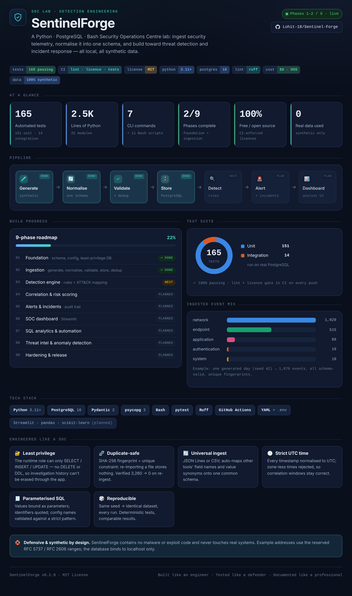
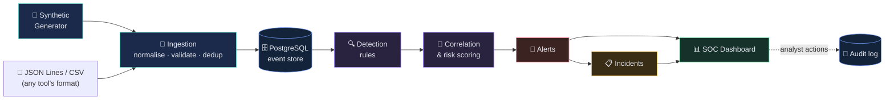

<div align="center">

# 🛡️ SentinelForge

### Enterprise Security Monitoring, Threat Detection & Incident Response Lab

A **Python · PostgreSQL · Bash** Security Operations Centre (SOC) lab that ingests security telemetry, normalises it into one schema, and builds toward threat detection, event correlation and incident investigation — running entirely on your own machine with **synthetic data only**.

<br>

[](https://github.com/Lohit-18/Sentinel-Forge/actions/workflows/tests.yml)
[](LICENSE)
[](https://www.python.org/)
[](https://www.postgresql.org/)
[](https://github.com/astral-sh/ruff)
[](docs/cost-and-licences.md)
[](#-safety--ethics)
[](#-roadmap)

<br>

[**Quick start**](#-quick-start) · [**Dashboard**](#-project-dashboard) · [**Architecture**](#-architecture) · [**Example output**](#-example-output) · [**Roadmap**](#-roadmap)

</div>

---

## 📊 Project dashboard

<div align="center">



*A technical overview of the project — pipeline, 9-phase roadmap, test suite and tech stack.
Open [`dashboard.html`](dashboard.html) in a browser for the interactive version (light + dark).*

</div>

---

## 📖 Overview

Every security tool speaks its own language. One log calls a field `timestamp`, another `TimeCreated`; one says `FAILED`, another `denied`. A real SOC first **translates everything into one common shape**, then runs detection, correlation and investigation on top of it.

SentinelForge is a hands-on model of that pipeline, built from scratch to be **technically substantial, reproducible, and free to run** — a portfolio and learning project for blue-team and detection-engineering skills, and the kind of system you can build, demonstrate, break, fix, and *explain line by line*.

> [!NOTE]
> **Status — Phases 1–2 of 9 complete.** The foundation and the full **ingestion pipeline** (generate → normalise → validate → store, with duplicate detection) are implemented and covered by **165 passing tests** against a real PostgreSQL server. Detection, correlation, alerting, incidents and the analyst dashboard are on the [roadmap](#-roadmap).

### Why this is not a toy

- **Real database engineering** — SQL migrations, indexes, foreign keys, a least-privilege application role, parameterised queries.
- **Real data handling** — strict schema validation, UTC normalisation, multi-format ingestion (JSON Lines + CSV), SHA-256 de-duplication.
- **Real quality bar** — unit *and* integration tests, CI on every push, a linter with security rules, and an automated open-source-licence check.
- **Honest by design** — only working commands ship; every output in this README is produced by the code (see [Example output](#-example-output)), never invented.

---

## 🏗️ Architecture



Solid boxes are **built and tested**; detection → dashboard is the roadmap. Full write-up: [`docs/architecture.md`](docs/architecture.md).

---

## ✨ What works today

| Capability | Command |
|---|---|
| 🧪 Generate deterministic synthetic activity | `sentinelforge events generate --days 3` |
| 🧾 Validate an event file against the schema | `sentinelforge events validate FILE` |
| 📥 Ingest events into PostgreSQL (skips duplicates) | `sentinelforge events ingest FILE` |
| 🧱 Apply database migrations | `sentinelforge db migrate` |
| 🔐 Create the least-privilege app role + schema | `sentinelforge db bootstrap` |
| 🩺 Check database connectivity & privileges | `sentinelforge db status` |
| ⚙️ Show configuration (passwords hidden) | `sentinelforge config show` |

**Highlights**

- 🔄 **Universal ingestion** — JSON Lines **or** CSV; auto-maps other tools' field names (`TimeCreated`, `AccountName`, …) and value synonyms (`FAILED`, `denied` → `failure`) onto one schema. Unknown fields are preserved in `raw`, never silently dropped.
- 🕑 **Strict time handling** — every timestamp normalised to UTC; zone-less times are rejected rather than guessed, so correlation windows stay correct.
- 🧬 **Duplicate-safe** — a SHA-256 fingerprint + unique constraint make re-importing a file a no-op (verified: 1,670 events → 0 stored on re-ingest).
- 🔐 **Security-first storage** — the app role can only `SELECT/INSERT/UPDATE`; it **cannot** `DELETE` or `DROP`, so investigation history can't be erased through the app.
- 🎲 **Reproducible** — the same seed always produces exactly the same synthetic dataset.

---

## 🧰 Tech stack

| Layer | Technology | Why |
|---|---|---|
| **Language** | Python 3.11+ | Validation, ingestion, CLI, tooling |
| **Database** | PostgreSQL 16 | Durable store; CTEs & window functions for analytics |
| **Validation** | Pydantic 2 | Strict, self-documenting event & config schemas |
| **DB driver** | psycopg 3 | Parameterised SQL + safe identifier quoting |
| **Automation** | Bash | Reproducible setup, start/stop, demo, backups |
| **Tests** | pytest | Unit + integration against real PostgreSQL |
| **Quality** | Ruff | Linting (incl. security rules) + formatting |
| **CI** | GitHub Actions | Lint, licence check & tests on every push |
| **Config** | YAML + `.env` | Synthetic inventory; secrets kept out of git |

> Planned for later phases (all free & open source): **Streamlit** (analyst dashboard), **pandas** (analytics), **scikit-learn** (optional anomaly detection), **FastAPI** (optional API).

---

## 🚀 Quick start

> **Requirements:** Linux, macOS, or Windows with **WSL 2** · Python 3.11+ · PostgreSQL 16. Docker is optional. Full guide → [`docs/installation.md`](docs/installation.md).

```bash
# 1. Clone
git clone https://github.com/Lohit-18/Sentinel-Forge.git
cd Sentinel-Forge

# 2. Set up (virtualenv, dependencies, .env with random passwords)
bash scripts/setup.sh
bash scripts/setup_native_db.sh     # first run only: PostgreSQL admin role + database

# 3. Launch & verify
bash scripts/start_lab.sh
bash scripts/run_tests.sh --integration
```

### ▶️ See it all in one go

```bash
bash scripts/run_demo.sh
```

Starts the lab → generates synthetic events → ingests them → re-ingests the same file (every event detected as a duplicate) → runs the full test suite.

---

## 🧪 Example output

Real output, captured from the code — full transcript in [`examples/example_run.md`](examples/example_run.md):

```console
$ sentinelforge events ingest examples/background_1day_seed42.jsonl
Ingested examples/background_1day_seed42.jsonl
  Records read: 1670
  Stored:       1670
  Duplicates:   0 (already in the database)
  Invalid:      0
Result: OK

$ sentinelforge events ingest examples/background_1day_seed42.jsonl   # again
  Stored:       0
  Duplicates:   1670 (already in the database)
Result: OK
```

A different tool's CSV is normalised automatically:

```console
$ sentinelforge events ingest other_tool.csv --dataset-id csv_demo
#  TimeCreated → event_time, AccountName → user, SUCCEEDED/DENIED → success/failure
  Records read: 2
  Stored:       2
Result: OK
```

A ready-made **1,670-event sample dataset** lives in [`examples/background_1day_seed42.jsonl`](examples/background_1day_seed42.jsonl).

---

## 🖥️ CLI reference

```text
sentinelforge
├── config  show                 # settings, passwords masked
├── events
│   ├── generate                 # deterministic synthetic activity  (--days --seed)
│   ├── validate                 # check a file against the schema  (--show-normalised)
│   └── ingest                   # load .jsonl/.csv into PostgreSQL, skipping duplicates
└── db
    ├── bootstrap                # create/refresh the least-privilege app role + schema
    ├── migrate                  # apply pending SQL migrations
    └── status                   # connectivity + privilege health check
```

Exit codes are script-friendly: `0` success · `1` problem found · `2` usage/config error · `3` database unavailable.

---

## 📂 Project layout

```
Sentinel-Forge/
├── src/sentinelforge/
│   ├── cli.py · config.py · timeutil.py · inventory.py
│   ├── events/   schema · normalise · readers · fingerprint · validate · ingest
│   ├── generator/   deterministic synthetic activity
│   └── db/   bootstrap · migrate · events_repo · status · connect
├── migrations/                 # numbered SQL migrations
├── configs/lab_inventory.yml   # synthetic identities & assets
├── scripts/                    # 11 Bash automation scripts
├── tests/{unit,integration}/   # 165 tests
├── examples/                   # ready-made dataset + captured run transcript
├── docs/                       # architecture · schemas · installation · cost & licences
├── dashboard.html              # interactive project dashboard (open in a browser)
└── .github/workflows/tests.yml # CI: lint + licence check + tests
```

---

## 🧪 Testing & quality

```bash
bash scripts/run_tests.sh                 # lint + 151 unit tests (no database needed)
bash scripts/run_tests.sh --integration   # + 14 integration tests on real PostgreSQL
bash scripts/lint.sh                       # Ruff lint + format check
bash scripts/check_licences.sh             # every dependency must be free/open source
```

| Metric | Value |
|---|---|
| ✅ Tests | **165** (151 unit · 14 integration) |
| 🐍 Python source | ~2,500 lines across 22 modules |
| 🧾 Test code | ~1,360 lines across 13 files |
| 📦 Dependencies | 100% free / open-source (CI-enforced) |

Integration tests run in a throwaway schema and role that are dropped afterwards — your lab data is never touched.

---

## 🔐 Security design

SentinelForge practises what a SOC preaches:

- **Least privilege** — a separate admin role owns the schema; the runtime role has no `DELETE`/`DDL`.
- **Parameterised SQL everywhere** — values as parameters, identifiers quoted via `psycopg.sql`, config names validated against a strict pattern.
- **Secrets stay out of git** — `.env` is generated with owner-only permissions, listed in `.gitignore`, and *parsed, never executed* by shell scripts.
- **Strict input validation** — invalid records are rejected, not stored.
- **Local by default** — PostgreSQL binds to `127.0.0.1` only.

Details: [`SECURITY.md`](SECURITY.md).

---

## 🗺️ Roadmap

- [x] **Phase 1 — Foundation** · schema, config, least-privilege database
- [x] **Phase 2 — Ingestion** · generator, normalisation, validation, storage, de-duplication
- [ ] **Phase 3 — Detection engine** · configurable rules with MITRE ATT&CK mapping
- [ ] **Phase 4 — Correlation & risk scoring** · link related events, score by evidence
- [ ] **Phase 5 — Alerts & incidents** · status workflow, investigation notes, audit trail
- [ ] **Phase 6 — SOC dashboard** · Streamlit analyst UI
- [ ] **Phase 7 — SQL analytics & automation** · threat-hunting queries, reporting
- [ ] **Phase 8 — Threat intel & anomaly detection** · indicators, optional ML
- [ ] **Phase 9 — Hardening & release** · docs, screenshots, evaluation metrics

---

## 🧭 Scope & relationship to my other projects

SentinelForge is its own system. It is **not** derived from, and shares no code or data model with, my other security projects:

| Project | Focus | Core tech |
|---|---|---|
| **SentinelForge** | **SOC log ingestion → monitoring → investigation** across many telemetry types | **Python · PostgreSQL · Pydantic · Bash** |
| Chrono-DNS | DNS-layer threat detection (tunnelling, DGA, C2) | Python · scikit-learn · DNS proxy |
| CAN-Guard | In-vehicle CAN-bus intrusion detection | Python · TensorFlow |
| Aegis | Prompt-injection firewall for LLM APIs | Python · FastAPI |

Different problem, different data, different architecture — SentinelForge is the broad **SOC platform**, not a single-signal detector.

---

## 🛟 Safety & ethics

SentinelForge is a **defensive** learning tool.

- 🧪 **Synthetic data only** — no real traffic, credentials, or private data.
- 🚫 **No malware, no exploits, no attacks** on real systems.
- 🌐 **Reserved ranges** — example IPs use [RFC 5737](https://www.rfc-editor.org/rfc/rfc5737); domains use [RFC 2606](https://www.rfc-editor.org/rfc/rfc2606).
- 🔒 **Runs locally** and never contacts external infrastructure.

---

## 📄 Licence

Released under the **MIT License** — see [`LICENSE`](LICENSE). Free to use, modify and share with attribution.

<div align="center">
<br>

**Built like an engineer. Tested like a defender. Documented like a professional.**

⭐ *If this project is useful or interesting, consider starring the repo.*

</div>
