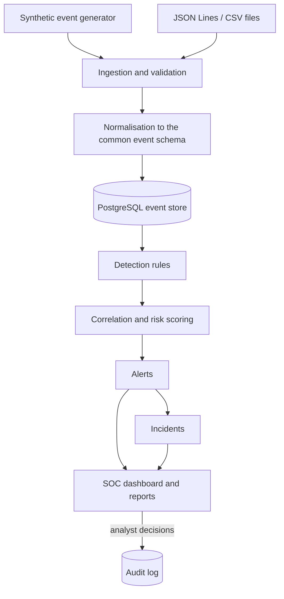

# Architecture

SentinelForge simulates the workflow of an enterprise Security Operations Centre (SOC) on one computer, using synthetic data only.

## Components and build status

| Component | What it does | Status |
|---|---|---|
| Configuration (`config.py`) | Reads `SF_*` settings from the environment and `.env`; hides passwords | Phase 1, done |
| Event schema (`events/schema.py`) | Defines and validates `SecurityEvent` | Phase 1, done |
| File validation (`events/validate.py`) | Checks a JSON Lines file line by line | Phase 1, done |
| Database bootstrap (`db/bootstrap.py`) | Creates the least-privilege app role and schema | Phase 1, done |
| Database status (`db/status.py`) | Checks connectivity and privileges | Phase 1, done |
| CLI (`cli.py`) | `sentinelforge` command | Phase 1, partial |
| Event generator, ingestion, migrations | | Phase 2 |
| Detection engine | | Phase 3 |
| Correlation, risk scoring, alerts | | Phase 4 |
| Incidents and reports | | Phase 5 |
| Streamlit dashboard | | Phase 6 |
| Analytical SQL, remaining Bash automation | | Phase 7 |
| Threat intelligence, optional ML | | Phase 8 |

## Database roles

| Role | Used by | Can do |
|---|---|---|
| `sentinelforge_admin` | setup scripts and migrations only | owns the schema, creates tables |
| `sentinelforge_app` | the running application | `SELECT`, `INSERT`, `UPDATE` on tables in the `sentinelforge` schema. Cannot `CREATE`, `DROP`, `ALTER`, `DELETE` or `TRUNCATE`. |

Splitting the roles limits the damage from a bug or from an attacker who abuses the application. Because the app role has no `DELETE`, the alert and investigation history cannot be erased through the application. Data retention (deleting old data) is an admin task, documented in Phase 7.

## Dependencies

| Dependency | Purpose | Added in |
|---|---|---|
| pydantic | Validates events and settings with clear error messages | Phase 1 |
| pydantic-settings | Loads `SF_*` settings from environment variables and `.env` | Phase 1 |
| psycopg 3 | PostgreSQL driver with parameterised queries and safe identifier quoting | Phase 1 |
| pytest | Test runner | Phase 1 |
| Ruff | Linter (including security checks) and formatter | Phase 1 |
| PostgreSQL 16 | Persistent storage (native install by default; Docker optional) | Phase 1 |

All of these are free and open source; see [cost-and-licences.md](cost-and-licences.md). Planned for later phases, added only when they are used: Streamlit (dashboard), pandas (analysis for the dashboard and reports), FastAPI (optional API), scikit-learn (optional ML experiments).

### Design decision: psycopg instead of an ORM

SQLAlchemy is a popular choice, but SentinelForge writes its SQL explicitly with psycopg. This keeps the queries visible (correlation and reporting rely on CTEs and window functions that are clearer as SQL), uses one fewer dependency, and still gets parameterised queries. The trade-off is that table-to-object mapping is written by hand.

### Design decision: argparse for the CLI

The CLI uses Python's built-in `argparse` rather than Click or Typer. It needs no extra dependency and covers sub-commands, help text and argument validation. The trade-off is a little more boilerplate.

## Relationship to Chrono-DNS

[Chrono-DNS](https://github.com/Lohit-18/chrono-dns) and SentinelForge are separate projects with separate code, databases and branding.

| | Chrono-DNS | SentinelForge |
|---|---|---|
| Purpose | Inline DNS security gateway | SOC monitoring and investigation lab |
| Data | DNS queries | Authentication, endpoint, network, system and application events |
| Main question | "Is this DNS query malicious?" | "What happened across the environment, and how should an analyst respond?" |
| Output | Allow or sinkhole a query | Alerts, incidents, investigation history, reports |

In the future SentinelForge may import alerts from tools such as Chrono-DNS through the external-alert interface, as one data source among many.
